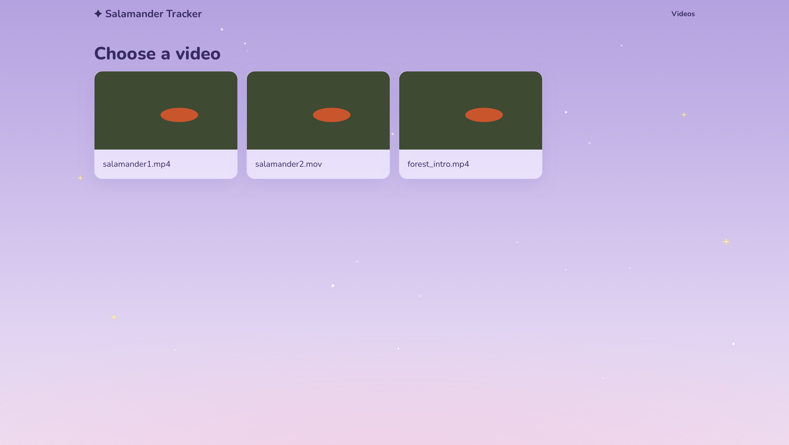
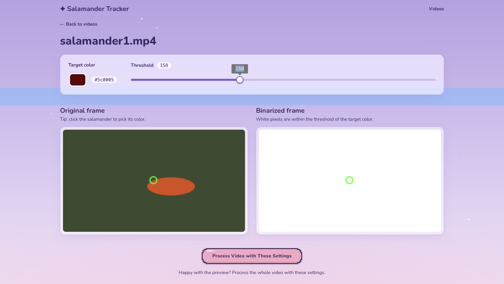

# Salamander Tracker (Centroid Finder Frontend)

A React app for tracking a salamander (or any colored object) in a video.
Pick a video, tune the target color and threshold while watching a live
black-and-white preview, then send the video to the server for processing
and download a CSV of where the object was over time.

This is the frontend. The backend (Express server + Java video processor)
is in [centroid-finder](https://github.com/kacastillo/centroid-finder) on the `server` branch.

## Features

- **Video Chooser** (`/videos`): lists the videos available on the server.
- **Live preview** (`/preview/:filename`): shows the video's first frame next to a
  binarized (black-and-white) version that updates as you move the threshold
  slider or change the color. A green ring marks the centroid of the largest group.
- **Process a video:** "Process Video with These Settings" starts a job on the server.
- **Job status:** shows progress while the video is processing, then a link to download the CSV.
- **Unique feature, eyedropper:** click anywhere on the original frame to pick that
  pixel's color as the target color.

The binarizing and group-finding logic is a JavaScript port of our Java code
(EuclideanColorDistance, DistanceImageBinarizer, DfsBinaryGroupFinder),
so the preview matches what the server produces.

## Screenshots





## Tech stack

- React + Vite
- React Router
- Material UI
- Mocha (logic tests) and Cypress (page tests)

## Setup

### 1. Backend (run this first)

Requirements: Node.js, Java 21+, Maven, and FFmpeg (`brew install ffmpeg`).

```bash
git clone https://github.com/kacastillo/centroid-finder.git
cd centroid-finder
git switch server

# Build the Java video processor
cd processor
mvn package
cd ..

# Put your videos in a videos/ folder in the main folder (not committed)
mkdir videos

# Start the server on port 3000
cd server
npm install
npm run dev
```

### 2. Frontend

```bash
git clone https://github.com/kacastillo/centroid-finder-frontend.git
cd centroid-finder-frontend
npm install
npm run dev
```

Open http://localhost:5173/videos.

The Vite dev server forwards `/api`, `/thumbnail`, `/process`, and `/results`
to the backend on port 3000 (see `vite.config.js`).

### Mock data vs. the real server

By default the app uses **mock data**, so it works without the backend.
To use the real server, create a `.env.local` file in the frontend folder:

```
VITE_USE_MOCK=false
```

Then restart `npm run dev`.

## Running the tests

**Logic tests (Mocha):** the JavaScript port of the Java code.

```bash
npm run test:logic
```

**Page tests (Cypress):** the server is faked with `cy.intercept`, so the
backend doesn't need to be running.

```bash
# Terminal 1: start the app with mocks off
npm run dev:api

# Terminal 2: run the tests
npm run test:e2e
```

## Project structure

```
src/
├── api/          api.js: every server call (mock or real)
├── mock/         mock data for development
├── lib/          JS port of the Java logic: colors, binarize, findCentroid
├── hoc/          withLoading: adds a loading spinner and error message
├── hooks/        useJobStatus: checks the job status until it's done
├── components/   VideoCard, ControlsPanel, ThumbnailCanvas,
│                 BinarizedCanvas, ProcessButton, JobStatus, Sky
└── pages/        Home, VideoChooser, PreviewPage
test/             Mocha tests for src/lib
cypress/e2e/      Cypress tests for the pages
```

## Team

- **Kate Nguyen** ([@MeoMeoDestroyer](https://github.com/MeoMeoDestroyer)): app setup,
  JS port of the Java logic and its tests, live preview canvases, controls,
  preview page, eyedropper
- **Kelley Castillo** ([@kacastillo](https://github.com/kacastillo)): API layer
  and mock data, Video Chooser, loading HOC, process button, job status,
  Cypress setup and tests